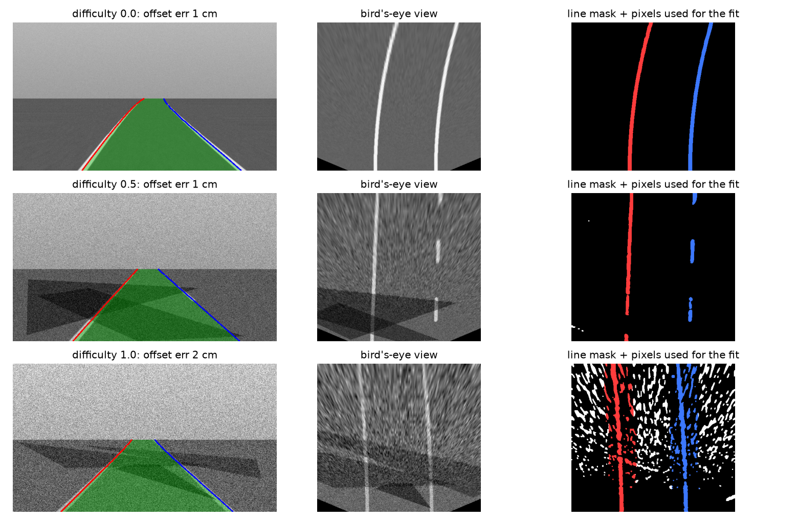
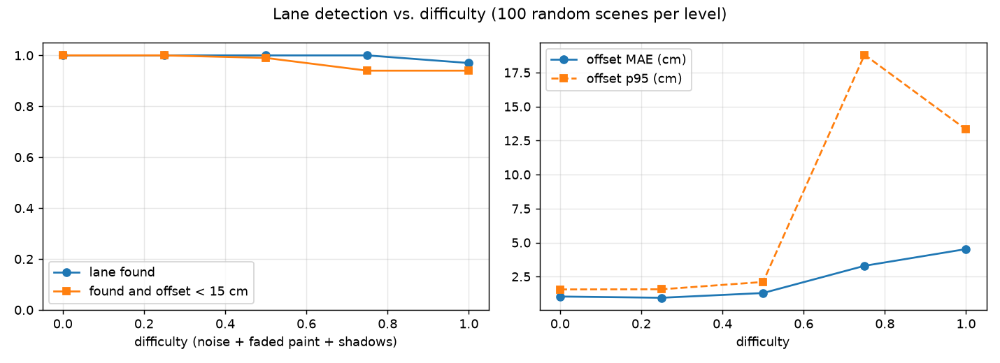

# Lane Detection and Lateral Offset Estimation for ADAS

A classical computer-vision lane perception module of the kind used in **lane-keeping assist (LKA) and lane-departure warning**, built and benchmarked against exact ground truth. It outputs the three numbers a vehicle controller actually needs: **lateral offset from the lane centre, lane curvature and lane width**, in metres, not just pixels.



*Rows: easy, medium and hard scenes (sensor noise, faded paint, shadows). Left: detected lane overlay. Middle: bird's-eye view. Right: line mask and the pixels used for each fit.*

## Pipeline

```
camera frame ─▶ inverse perspective mapping ─▶ top-hat line filter + Otsu ─▶ sliding windows
                (calibrated homography)         (kills shadow edges)         (dashed lines OK)
              ─▶ quadratic fit in metres ─▶ outlier rejection + refit ─▶ plausibility checks
                 x = A·y² + B·y + C          (|residual| < 25 cm)         (width, parallelism)
```

- **Top-hat instead of plain edge detection**: a painted line is a thin bright structure, a shadow border is a large step. Morphological top-hat responds to the first and ignores the second, which keeps accuracy high on shadowed roads.
- **Fits are done in metres**, so offset, curvature and width fall straight out of the polynomial coefficients.
- **Plausibility checks** reject results where the lane is not 2.8-4.5 m wide at several distances: returning *"no lane"* is safer than returning a wrong lane to a controller.

## Results

100 random scenes per difficulty level (difficulty scales sensor noise, paint fading and the number of shadows; the right line is dashed in half of the scenes):

| Difficulty | Lane found | Found and offset < 15 cm | Offset MAE | Offset p95 | Curvature MAE |
|---|---|---|---|---|---|
| 0.00 | 100% | 100% | 1.0 cm | 1.6 cm | 0.07 /km |
| 0.25 | 100% | 100% | 0.9 cm | 1.6 cm | 0.07 /km |
| 0.50 | 100% | 99% | 1.3 cm | 2.1 cm | 0.15 /km |
| 0.75 | 100% | 94% | 3.3 cm | 18.8 cm | 1.19 /km |
| 1.00 | 97% | 94% | 4.5 cm | 13.3 cm | 2.57 /km |



### Calibration sensitivity (the part most demos skip)

The renderer and the detector share one camera model, so the table above is a *best case*. In a real car the camera pitch drifts with load and braking. To quantify this, the detector is run with a homography whose horizon is shifted by a few pixels:

| Horizon error | Lane found | Offset MAE | Curvature MAE |
|---|---|---|---|
| 0 px | 100% | 0.9 cm | 0.07 /km |
| ±3 px | 100% | 0.9 cm | 0.6 /km |
| ±6 px | 92-100% | 1.0 cm | 1.0-1.4 /km |

**Lateral offset is almost immune to pitch error** because both lines are distorted symmetrically and the lane centre stays put. **Curvature is not**: a 3 px pitch error already makes it about 8x worse. A production system therefore needs online pitch estimation (for example from the vanishing point) before its curvature output can drive steering.

## Limitations

- Synthetic scenes: no real-world lens distortion, no other vehicles, no worn or double lines. Judge the numbers as a controlled benchmark, not a road test.
- Gentle curves only (radius above about 170 m), a single ego lane, grayscale input.
- Single-frame estimates; a real system adds temporal filtering (Kalman filter on the polynomial coefficients).

## Project structure

```
src/lanes/
  geometry.py    # BEV grid, camera homography, metre <-> pixel conversions
  sim.py         # scene renderer with exact ground truth, shadows, noise, faded and dashed paint
  detect.py      # IPM, top-hat extraction, sliding windows, polynomial fit, sanity checks
  experiment.py  # benchmark, calibration sensitivity, figures
tests/           # geometry round-trips, determinism, accuracy on a clean scene, failure handling
```

## Quickstart

```bash
python -m venv .venv && source .venv/bin/activate
pip install -r requirements.txt
PYTHONPATH=src python -m lanes.experiment
pytest
```

## Tech stack

Python · OpenCV · NumPy · Matplotlib · pytest

---

### 🇹🇷 Türkçe özet

İleri sürücü destek sistemleri (ADAS) için şerit takibi modülü: kuş bakışı dönüşümü, top-hat ile ince çizgi çıkarma (gölge kenarlarını bastırır), kayan pencereler ve metre cinsinden ikinci derece polinom uyumu. Çıktı olarak yanal ofset, eğrilik ve şerit genişliğini verir. Zor koşullarda (gürültü, silik boya, gölge) ofset hatası ortalama 4,5 cm. Kalibrasyon hassasiyet deneyi gösteriyor ki **ofset kamera eğim hatasına neredeyse duyarsız, eğrilik ise 3 piksellik hatada yaklaşık 8 kat bozuluyor**; yani gerçek araçta çevrim içi eğim kestirimi şart.
